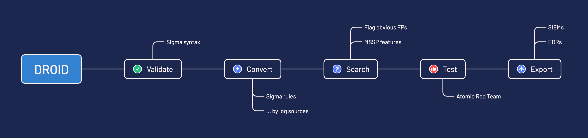

---
hide:
  - navigation
---

# droid

`droid` enables **Detection as Code using [Sigma](https://sigmahq.io/)**. Keep your detection rules as Sigma in a Git repository, and `droid` validates them, converts them for each of your platforms, searches your logs with them and deploys them to your SIEM and EDR, from your laptop or your CI/CD pipeline.

Built on [pySigma](https://github.com/SigmaHQ/pySigma), `droid` also handles rules written directly in a platform's query language, the [raw rules](./raw_rules.md).



<div class="grid cards" markdown>

-   :material-clock-fast:{ .lg .middle } __Set up in minutes__

    ---

    Install [`detect-droid`](https://pypi.org/project/detect-droid/) with `pip`, add the pySigma backends of your platforms, and convert your first rules.

    [:octicons-arrow-right-24: Getting started](./getting-started.md)

-   :material-source-branch:{ .lg .middle } __Detection as Code__

    ---

    Review, version and roll back your detection rules like code, and let your CI/CD pipeline test and deploy them.

    [:octicons-arrow-right-24: Usage](./usage.md)

-   :simple-toml:{ .lg .middle } __Made to measure__

    ---

    Map each log source to your data with its own pipelines, and tune schedules, suppression and actions per platform, log source or rule.

    [:octicons-arrow-right-24: Configuration](./configuration.md)

-   :material-scale-balance:{ .lg .middle } __Open source, EUPL__

    ---

    `droid` is licensed under the EUPL and developed in the open on [GitHub](https://github.com/certeu/droid).

    [:octicons-arrow-right-24: License](https://github.com/certeu/droid/blob/main/LICENSE)

</div>

## Features

- **Validate** the syntax and the quality of your Sigma rules with the pySigma validators
- **Convert** them for each platform, with the pipelines you set per log source
- **Search** your logs with them, and report the hits before going live
- **Export** them to your platforms: create, update, disable and remove detection rules
- **Check the integrity** of what runs on a platform against your repository
- **Correlate** with Sigma correlation rules
- **Serve one log source from several telemetry sources**, each converted with its own pipelines, see [Log source variants](./log_source_variants.md)
- **Manage several tenants** (MSSP) with per customer filters
- **Update** your rules from upstream sources such as SigmaHQ

## Supported platforms

| Platform | `--platform` | Search | Export | Integrity | Rule actions | MSSP |
| --- | --- | :---: | :---: | :---: | --- | :---: |
| [Splunk](./platforms/splunk.md) | `splunk` | ✅ | ✅ | ✅ | Email, webhook | |
| [Microsoft Sentinel](./platforms/microsoft_sentinel.md) | `microsoft_sentinel` | ✅ | ✅ | ✅ | | ✅ |
| [Microsoft Defender XDR](./platforms/microsoft_xdr.md) | `microsoft_xdr` | ✅ | ✅ | ✅ | Response actions on users, files and devices | ✅ |
| [Elastic Security](./platforms/elastic_security.md) (ES\|QL) | `esql` | ✅ | ✅ | ✅ | Index, server log, email, webhook | |
| [Elastic Security](./platforms/elastic_security.md) (EQL) | `eql` | ✅ | ✅ | ✅ | Index, server log, email, webhook | |

???+ info

    Each platform needs its pySigma backend, see [Getting started](./getting-started.md). Your platform is missing? [Contributions](https://github.com/certeu/droid/blob/main/CONTRIBUTE.md) are welcome.

## At a glance

```sh
droid rules validate  -r sigma-rules/ -c droid_config.toml              # check your rules
droid rules convert   -r sigma-rules/ -c droid_config.toml -p splunk    # see the queries they become
droid rules search    -r sigma-rules/ -c droid_config.toml -p splunk    # search your logs with them
droid rules export    -r sigma-rules/ -c droid_config.toml -p splunk    # deploy them
droid rules integrity -r sigma-rules/ -c droid_config.toml -p splunk    # check what runs on the platform
```

## Resources

- [Sigma Unleashed: A Realistic Implementation](https://www.first.org/resources/papers/conf2024/1315-1350-Sigma-Unleashed-Mathieu-Le-Cleach.pdf), FIRST 2024
- [droid-init](https://github.com/certeu/droid-init), a repository to start your detection rules from
